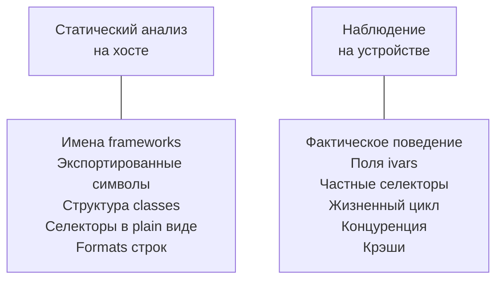

# Глава VI.2. Статический анализ vs наблюдения на устройстве

Пара глав Части VI закрывается этой: когда расследовать достаточно статически (без устройства), а когда без устройства не обойтись. Это важно для организации работы: статический анализ быстрее и дешевле, но имеет границы.

## 1. Карта возможностей



Таблица «что знаем — без устройства / с устройством»:

| Что | Статически | На устройстве |
|---|---|---|
| Имя публичного класса | ✓ (SDK headers) | ✓ |
| Имя private класса | частично (class-dump dyld_shared_cache) | ✓ (objc_copyClassList) |
| Селектор публичного метода | ✓ | ✓ |
| Селектор private метода | частично | ✓ (class_copyMethodList) |
| Сигнатура (return + args) | частично | ✓ (method_copyReturnType) |
| Поведение метода | — | ✓ (shadow hook + log) |
| Поля ivars объекта | частично | ✓ (object_getIvar) |
| Как часто вызывается | — | ✓ (счётчик в хуке) |
| Между какими процессами XPC | ✓ (plist of mach-services) | ✓ |
| Какой демон делает X | ✓ (strings + otool) | ✓ (log stream) |
| Что сломается от хука | — | только тестом |
| Утечка памяти | возможно (static analyzer) | ✓ (Instruments) |

Короткое правило: **статически — структура, на устройстве — поведение**.

## 2. Что можно делать без устройства

Это важно: при разработке в поезде, в самолёте, или если у вас одно устройство и вы боитесь его ломать.

### 2.1. SDK — ваш первый источник

Публичные headers:

- iOS SDK: `/Applications/Xcode.app/Contents/Developer/Platforms/iPhoneOS.platform/Developer/SDKs/iPhoneOS<ver>.sdk/`
- Внутри — `System/Library/Frameworks/<Framework>.framework/Headers/*.h`.

Что здесь есть:

- Все классы, экспортируемые Apple как публичные.
- Все методы с сигнатурами.
- Все enum, structs, constants.

Чего нет:

- Private классов (их headers Apple не публикует).
- Private методов публичных классов.

### 2.2. dyld_shared_cache

Это тот самый большой артефакт, в котором живут **все** фреймворки iOS. Распространяется с IPSW файлом.

Если у вас есть IPSW iOS 26.0 или 26.0.1 (можно скачать с Apple, если устройство устарело, или получить легитимно):

```bash
# Через ipsw CLI (ipsw.io):
ipsw extract --dyld /path/to/iPhone11,2_26.0_...ipsw
# Создаст dyld_shared_cache_arm64 (или arm64e, в зависимости от device)

# Прочитать список frameworks:
ipsw dyld info dyld_shared_cache_arm64

# Выгрузить один framework:
ipsw dyld extract dyld_shared_cache_arm64 \
    --image "/System/Library/CoreServices/SpringBoard.app/SpringBoard"
```

После этого у вас есть **настоящий бинарник SpringBoard на iOS 26** в руках, можно class-dump:

```bash
class-dump-dyld SpringBoard --output /tmp/sbdump
```

**Статически** вы получили список всех классов SpringBoard, их методов. Без устройства.

### 2.3. Класс-дампы в сообществе

Сообщество часто публикует class-dumps для popular iOS versions:

- github.com/<various>/iOS-Runtime-Headers — не все актуальны для iOS 26.
- github.com/<various>/dumps — иногда есть.

**Проверка актуальности**: обязательна. iOS 26 — свежая, и dumps могут быть неточными. Используйте как ориентир, верификация — только на устройстве.

### 2.4. Строки в бинарнике

Отдельный мощный инструмент — `strings`:

```bash
strings SpringBoard | grep -i "lowbattery" | head
```

Выдаст контекстные строки, из которых можно понять, где и как используется функциональность.

### 2.5. Инструменты статического анализа

- **MachOView** (GUI, macOS) — удобный просмотрщик Mach-O.
- **otool** (CLI) — всё, что нужно для командной строки.
- **class-dump / class-dump-dyld** — классовая структура.
- **Hopper Disassembler / Ghidra / IDA Pro** — reverse engineering.

Hopper и Ghidra дают **псевдокод** от инструкций ARM64. Это **медленно** и требует навыка reverse engineering, но даёт понимание поведения метода без устройства.

## 3. Что требует устройства

Короткий список:

- **Реальное поведение метода**. Какие аргументы приходят, в каком контексте, с какой частотой.
- **Поля ivars объектов** в рантайме — что находится в адресе объекта.
- **Концуренция** — какой поток вызывает X.
- **Крэши** — только на устройстве.
- **Производительность** — только на устройстве.
- **Взаимодействие с другими процессами** — XPC-трафик, mach messages.

Для всех этих задач нужно установить shadow-twик, запустить сценарий, собрать лог.

### 3.1. Классовые hierarchies в рантайме

```objc
Class cls = NSClassFromString(@"_SBUITimeLabel");
while (cls) {
    os_log(OS_LOG_DEFAULT, "class: %s", class_getName(cls));
    cls = class_getSuperclass(cls);
}
```

Выводит цепочку наследования. Статически вы знаете, что он subclass UILabel, но какой именно уровень — только через runtime.

### 3.2. ivar-layout

```objc
Class cls = NSClassFromString(@"_SBUITimeLabel");
unsigned int count = 0;
Ivar *ivars = class_copyIvarList(cls, &count);
for (unsigned int i = 0; i < count; i++) {
    const char *name = ivar_getName(ivars[i]);
    const char *type = ivar_getTypeEncoding(ivars[i]);
    os_log(OS_LOG_DEFAULT, "  ivar %s: %s", name, type);
}
free(ivars);
```

Выдаёт `_offset`, `_format`, etc. — поля, которые класс имеет. Доступ:

```objc
Ivar formatIvar = class_getInstanceVariable(cls, "_format");
if (formatIvar) {
    id formatVal = object_getIvar(someInstance, formatIvar);
    os_log(..., "format = %{public}@", formatVal);
}
```

Это даёт реальные значения в рантайме.

### 3.3. Поведение `respondsToSelector:`

```objc
BOOL has = [obj respondsToSelector:@selector(someMethod:)];
```

Если `has == NO`, значит метод в этом экземпляре не определён; хукать его бесполезно. Статически вы можете только предположить.

## 4. Как минимизировать время на устройстве

Устройство — лимитированный ресурс. Правила эффективности:

### 4.1. Batch-ваши вопросы

Не ходить на устройство ради одного probe. Собрать 10 вопросов, залить один комбинированный probe-твик, собрать все результаты.

Пример batch-probe:

```objc
%ctor {
    unsigned int count = 0;
    Class *classes = objc_copyClassList(&count);
    for (unsigned int i = 0; i < count; i++) {
        const char *name = class_getName(classes[i]);
        // Все интересные классы разом
        if (strcasestr(name, "lowbattery") || strcasestr(name, "lowpower") ||
            strcasestr(name, "alertcontroller") || strcasestr(name, "notification")) {
            os_log(OS_LOG_DEFAULT, "batch[%s]: ...", name);
            // + ivars + methods
        }
    }
    free(classes);
}
```

Один заход — 10 ответов.

### 4.2. SSH + fast reinstall pipeline

Сделайте SSH-based pipeline:

```bash
#!/bin/bash
# quick-install.sh
set -e
make clean package THEOS_PACKAGE_SCHEME=roothide
scp packages/*.deb mobile@mytweak-device:/tmp/
ssh mytweak-device "sudo dpkg -i /tmp/*.deb"
```

Это 10 секунд от правки кода до установки.

### 4.3. log stream на хосте

Не читайте лог через SSH:

```bash
# Плохо — медленно, overhead:
ssh mobile@<ip> "tail -f /var/log/syslog"

# Хорошо — быстро:
log stream --predicate 'subsystem == "com.example.probe"' --device <udid>
```

### 4.4. idevicesyslog

Если у вас устройство подключено по USB:

```bash
idevicesyslog | grep -i "probe"
```

Это самый быстрый поток в реальном времени.

## 5. Пример workflow: исследование private класса

Задача: узнать, какой класс рисует главный «пилюля» вокруг экрана блокировки на iOS 26 (т. н. Dynamic Island, если это актуально для вашего устройства).

### 5.1. Статическая часть (хост, без устройства)

```bash
# 1. Получить SpringBoard с ipsw
ipsw dyld extract dyld_shared_cache_arm64 \
    --image "/System/Library/CoreServices/SpringBoard.app/SpringBoard" \
    -o /tmp/sb

# 2. Поиск по строкам
strings /tmp/sb | grep -i "island\|cutout\|dynamic" | head

# 3. Class-dump
class-dump-dyld /tmp/sb -o /tmp/sbdump

# 4. Grep headers
grep -rln "IslandCutout\|DynamicIsland" /tmp/sbdump | head
```

Это даёт **список кандидатов** без устройства.

### 5.2. Device-side часть

Пишем probe:

```objc
%ctor {
    unsigned int count = 0;
    Class *classes = objc_copyClassList(&count);
    for (unsigned int i = 0; i < count; i++) {
        const char *name = class_getName(classes[i]);
        if (strcasestr(name, "island") || strcasestr(name, "cutout")) {
            os_log(OS_LOG_DEFAULT, "runtime: %s", name);
        }
    }
    free(classes);
}
```

Устанавливаем, запускаем SpringBoard — получаем **реально существующие классы на iOS 26**.

Сравниваем со статикой — те, что совпали, стабильны; те, что только в статике — переименованы; те, что только в рантайме — новые для iOS 26.

Этот workflow — максимально эффективное использование обоих источников.

## 6. Инструменты записи поведения

Отдельная категория — инструменты, которые записывают поведение приложения:

- **Instruments** (на Xcode) — allocations, time profiler, system trace, etc.
- **xcrun simctl** — для симулятора (но не jailbreak).
- **DTrace** (ограниченно на iOS, часто через SSH).

Instruments — лучший для производительности и утечек. Требует physical USB connection + вашу dylib с debug symbols.

## 7. Границы reverse engineering

Чего **нельзя** узнать без значительной работы:

- Содержимое Secure Enclave.
- Содержимое TXM / SPTM (iOS 17+ security).
- Приватные ключи, подписи, trust chains.
- Поведение, которое проверяется only в ядре.

Если ваш вопрос упирается в один из этих блоков — переформулируйте задачу или признайте «за моим горизонтом».

## 8. Этика

Короткая глава: некоторые задачи reverse engineering задевают права других.

- **Собственное приложение**: исследуйте что хотите.
- **Open-source приложение**: исследуйте, уважая лицензию.
- **Коммерческое приложение**: reverse engineering для совместимости — обычно легален, для копирования — обычно нет. Проверьте local law.
- **Системное API Apple**: технически RE того, что уже установлено на вашем устройстве, legal в большинстве юрисдикций, но Apple не одобряет distribution результатов.

Этот раздел — не юридическая консультация, но напоминание: инструменты в этой книге мощные; используйте ответственно.

## 9. Чеклист «статика vs устройство»

Прежде чем идти на устройство:

```
[ ] Статически проверил SDK headers?
[ ] Статически посмотрел strings бинарника?
[ ] Статически попробовал class-dump?
[ ] Статически применил grep на известные паттерны?
[ ] Собрал batch probe с несколькими вопросами?
```

Если все статические проверки сделаны и ответа не хватает — тогда device.

## 10. Что подтверждено

- **Подтверждено Apple docs**: `objc_copyClassList`, `class_copyMethodList`, `class_copyIvarList`, `object_getIvar`, `class_getSuperclass`, `respondsToSelector:` — публичные API.
- **Подтверждено ipsw.io tool**: `ipsw dyld extract` — для извлечения framework из dyld_shared_cache. Проверьте актуальную версию утилиты.
- **Подтверждено практикой**: `strings`, `otool`, `class-dump-dyld` — стандартные инструменты static analysis.
- **Требует проверки на устройстве**: что IPSW iOS 26.0/26.0.1 для вашего device доступен для скачивания — Apple периодически закрывает старые версии.
- **Не подтверждено**: что любой class-dump публично доступный актуален для iOS 26 — проверяйте.

## 11. Выводы

Главный тезис: **статический анализ даёт структуру, устройство — поведение**. Эффективная работа — комбинация обоих, с минимизацией visits на устройство через batch-probe.

Три якорных правила:

1. **Static first, device second**. Задать все вопросы статически, идти на устройство только за тем, что не удалось найти.
2. **Batch probe**. Один заход на устройство = много ответов.
3. **log stream с хоста**, не SSH tail. Быстрее, меньше шума.

На этом Часть VI закрывается. Вы знаете, как подойти к любой задаче исследования.

## 12. Что дальше

Часть VII — финальная техническая часть книги: **диагностика и качество**.

- Твик не загружается / dylib загружается, но hook не срабатывает — глава VII.1.
- Crash reports и полезное логирование — глава VII.2.
- Матрица отличий 26.0 vs 26.0.1 — глава VII.3.
