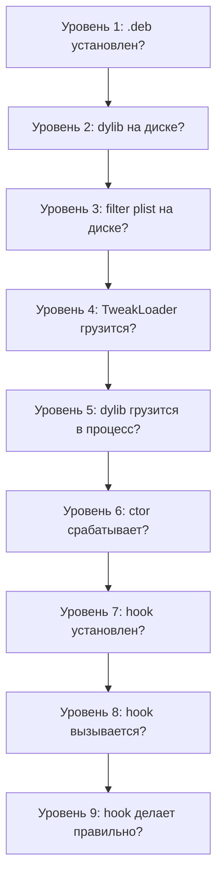

# Глава VII.1. Твик не загружается / dylib загружается, но hook не срабатывает

Эта глава — ваш первый ответ на самый частый вопрос: «почему не работает». Пройдём пошаговую диагностику — от «dpkg -i сказал OK» до «твик делает что должен», с таблицами симптомов и воспроизводимыми проверками.

## 1. Главный принцип диагностики

Диагностика твика строится по **нисходящей цепочке**:



Если проблема на уровне N — проверка на уровне N+1 бессмысленна. Диагностика идёт сверху вниз.

## 2. Уровень 1: `.deb` установлен?

### 2.1. Проверка

```bash
ssh mobile@<ip>
dpkg -l | grep <package-name>
```

Если видим:

```
ii  com.example.mytweak  0.0.1  MyTweak
```

→ установлен. Если пусто → не установлен.

### 2.2. Если не установлен

```bash
sudo dpkg -i /tmp/package.deb 2>&1 | tail -20
```

Типовые ошибки:

| Ошибка dpkg | Причина |
|---|---|
| `dependency problems — leaving unconfigured` | Depends не удовлетворены — установите недостающее |
| `cannot access archive` | Файл .deb не найден или нет прав |
| `invalid tar magic` | .deb повреждён |
| `conflicts with X` | Другой пакет конфликтует — удалите |

### 2.3. Проверка на RootHide

На Dopamine с RootHide dpkg может быть wrapped — проверьте через `which dpkg`:

```bash
which dpkg
# /var/jb/usr/bin/dpkg → ссылка в randomized jbroot
```

Если `/var/jb/usr/bin/dpkg` не найден — jbroot symlink сломан, Dopamine нужно восстановить.

## 3. Уровень 2: dylib на диске?

### 3.1. Проверка

```bash
ls -l /var/jb/Library/MobileSubstrate/DynamicLibraries/<TweakName>.dylib
# или через libroot path:
ls -l "$(jbroot)/Library/MobileSubstrate/DynamicLibraries/"<TweakName>.dylib
```

Должно быть:

```
-rwxr-xr-x 1 root wheel 123456 Oct 30 10:00 MyTweak.dylib
```

### 3.2. Распространённые проблемы

| Симптом | Диагноз |
|---|---|
| Файла нет | `dpkg -i` не распаковал — проверьте выше |
| Файл есть, но mode `-rw-r--r--` | Нет exec бита — dyld не загрузит; переустановите с правильным `.deb` |
| Файл есть, но 0 байт | Повреждение; переустановите |
| Owner не root | Неправильная сборка .deb; проверьте через `dpkg-deb -c` что owner = root/wheel |

## 4. Уровень 3: filter plist на диске?

### 4.1. Проверка

```bash
ls -l /var/jb/Library/MobileSubstrate/DynamicLibraries/<TweakName>.plist
plutil -p /var/jb/Library/MobileSubstrate/DynamicLibraries/<TweakName>.plist
```

Должно показать содержимое:

```
{
  "Filter" => {
    "Bundles" => [ 0 => "com.example.testbed" ]
  }
}
```

### 4.2. Распространённые проблемы

| Симптом | Решение |
|---|---|
| Файла нет | Theos не нашёл `<TWEAK_NAME>.plist` при сборке — проверьте имя |
| Файл есть, но невалидный XML | `plutil -lint` покажет ошибку; пересоберите |
| Bundles пуст | Проверьте filter plist исходник |
| Bundles содержит неверный id | Проверьте точный bundle id целевого приложения |

### 4.3. Важно: имя файла

`<TWEAK_NAME>.plist` должно совпадать с `TWEAK_NAME` в Makefile.

Если Makefile:

```make
TWEAK_NAME = MyTweak
```

Файл filter plist должен быть `MyTweak.plist`. Не `Tweak.plist`, не `mytweak.plist`, не `com.example.mytweak.plist`.

TweakLoader находит ваш `.dylib` → ищет `.plist` **с тем же base name** рядом → читает. Если имени несовпадение → `.plist` не найден → TweakLoader не знает, куда загружать → **ваш `.dylib` вообще не загружается ни во что**.

## 5. Уровень 4: TweakLoader грузится?

TweakLoader — ellekit (или substitute/substrate alternative). Он `dlopen`-ится из `systemhook.dylib` (глава III.5). Без TweakLoader ни один твик не загрузится.

### 5.1. Проверка

```bash
ls -l /var/jb/usr/lib/TweakLoader.dylib
# должен существовать
```

Или:

```bash
dpkg -l | grep ellekit
# ii  ellekit   X.Y.Z   ellekit
```

### 5.2. Если TweakLoader нет

Установите ellekit:

```bash
sudo dpkg -i /path/to/ellekit.deb
# или через Sileo/Zebra
```

### 5.3. TweakLoader установлен, но твики не грузятся

Проверьте safe_mode:

```bash
ls -la /var/jb/basebin/.safe_mode
```

Если файл есть — safe mode активен (глава III.5), и `systemhook` **не** загружает TweakLoader. Удалите:

```bash
sudo rm /var/jb/basebin/.safe_mode
killall -9 SpringBoard
```

### 5.4. Проверка через лог

Запустите целевое приложение, в `log stream`:

```bash
log stream --predicate 'process == "YourTargetProcess"' --device <udid> | grep -i tweak
```

Можно увидеть что-то вроде:

```
TweakLoader: starting
TweakLoader: dlopen'ing MyTweak.dylib
```

Если такого нет — TweakLoader не стартовал в целевом процессе.

## 6. Уровень 5: dylib грузится в процесс?

Теперь уже конкретно ваш `.dylib`.

### 6.1. Проверка через процесс

```bash
# На устройстве
ssh mobile@<ip>
ps -A | grep <target>
# Например, pid 1234 — TestbedApp

# Проверить загруженные dylib через vmmap (если доступен)
sudo vmmap 1234 2>/dev/null | grep -i mytweak
```

Или через list of modules самого приложения (из-внутри процесса — только через твик).

### 6.2. Проверка через `%ctor` + лог

Самый надёжный тест. Пустой `.dylib` с одним `%ctor`:

```objc
%ctor {
    NSLog(@"[MyTweak] loaded in %@", [NSProcessInfo processInfo].processName);
}
```

Запустите, в `log stream` ищите «[MyTweak] loaded». Если есть — dylib загружена. Нет — не загружена.

### 6.3. Распространённые причины

| Причина | Решение |
|---|---|
| Filter plist не ловит процесс | Проверьте bundle id; см. главу IV.3 |
| Процесс в blacklist Dopamine | Проверьте `BaseBin/libroothider/src/blacklist.m` (на устройстве — через `jbsettings`) |
| Процесс не получает `DYLD_INSERT_LIBRARIES` | Старые процессы, запущенные до jailbreak; respring/kill процесса |
| CoreFoundationVersion filter исключает | Если задан — проверьте range |
| libroot-dopamine не установлен | TweakLoader-side зависимость; `dpkg -l | grep libroot` |

## 7. Уровень 6: `%ctor` срабатывает?

Если на предыдущем уровне лог «loaded» виден — хорошо. Если нет, но dylib вроде загружен — `%ctor` падает.

### 7.1. Диагностика

Проверьте, не крэшит ли `%ctor`:

```bash
ssh mobile@<ip>
ls -t /var/mobile/Library/Logs/CrashReporter/ 2>/dev/null | head -5
# Если видите <TargetApp>-....ips — краш
cat /var/mobile/Library/Logs/CrashReporter/TargetApp-....ips | head -40
```

Если `faultingThread.frames` указывают на вашу dylib — краш в `%ctor`.

### 7.2. Распространённые причины краша `%ctor`

| Причина | Решение |
|---|---|
| Обращение к UIKit в `%ctor` до его готовности | Отложите в `dispatch_once` первого вью-event |
| `[UIApplication sharedApplication]` возвращает nil | То же |
| `[NSBundle mainBundle]` — не ваш бандл | Используйте `bundleWithPath:` с `JBROOT_PATH` |
| Выделение больших буферов | Отложите |
| Чтение неинициализированной глобальной | Проверка на nil |

### 7.3. Правильный шаблон `%ctor`

```objc
%ctor {
    // Только лёгкое:
    gLog = os_log_create("...", "...");
    gQueue = dispatch_queue_create("...", DISPATCH_QUEUE_SERIAL);
    pthread_key_create(&gKey, NULL);
    // Reload preferences
    reloadPrefs();
    // Register for notifications
    int token = 0;
    notify_register_dispatch(..., &token, gQueue, ^(int t){ reloadPrefs(); });
}
```

Всё остальное — в хуках методов, которые срабатывают позже.

## 8. Уровень 7: Hook установлен?

Если `%ctor` сработал, но хук «не ловит» — проверьте, что он реально установлен.

### 8.1. Проверка через лог

Добавьте в `%ctor` для диагностики:

```objc
%ctor {
    gLog = os_log_create("...", "...");

    // Проверка что класс существует
    Class cls = objc_getClass("TargetClass");
    if (!cls) {
        os_log_error(gLog, "Target class not found!");
        return;
    }
    os_log(gLog, "Target class OK: %p", cls);

    // Проверка что метод существует
    Method m = class_getInstanceMethod(cls, @selector(targetMethod));
    if (!m) {
        os_log_error(gLog, "Target method not found!");
        return;
    }
    os_log(gLog, "Target method OK: %p", m);
}
```

Запустите, посмотрите лог. Если «class not found» — класс переименован (глава V.2); если «method not found» — метод переименован.

### 8.2. Распространённые причины

| Причина | Решение |
|---|---|
| Класс не существует (переименован на iOS 26) | Пересмотрите class-dump или probe |
| Метод объявлен в superclass, не в этом классе | Хукните superclass |
| Метод inlined | Нельзя хукнуть — ищите другую точку |
| Static method vs instance method | `+` vs `-` в сигнатуре |
| Logos `%init` не вызван | Нужен `%init` явно, если используете `%hook SomeClass` без имени-плейсхолдера |

## 9. Уровень 8: Hook вызывается?

Хук установлен, но не вызывается — метод в целевом коде никогда не вызывается в текущем сценарии.

### 9.1. Диагностика

Добавьте шумный лог в хук:

```objc
%hook TargetClass
- (void)targetMethod {
    os_log(gLog, "targetMethod called!");
    %orig;
}
%end
```

Запустите, пройдите сценарий, который должен триггерить метод. В логе должно появиться «called!».

### 9.2. Если лога нет

Варианты:

- Метод не вызывается в данном сценарии (вы хукнули не тот).
- Хук перехвачен другим твиком (конфликт — глава "advanced/01").
- Метод вызывается в другом процессе (не том, куда загружен твик).
- Класс для хука правильный, но целевые объекты имеют другой класс (subclass или swizzling внутри Apple-code).

### 9.3. Проверка «кто реально отвечает»

Через probe на объект:

```objc
// В каком-то известном месте в твике:
Class actualClass = [someInstance class];
os_log(gLog, "actual class: %s", class_getName(actualClass));
```

Если `actualClass` не тот, что вы хукаете — хукните правильный.

## 10. Уровень 9: Hook делает правильно?

Хук срабатывает, но результат не тот.

### 10.1. Диагностика

Логируйте всё, что проходит:

```objc
%hook TargetClass
- (void)targetMethod:(NSString *)arg {
    os_log(gLog, "BEFORE: arg=%{public}@", arg);
    %orig(arg);
    os_log(gLog, "AFTER: ...");
}
%end
```

Это даёт `before`/`after` snapshot.

### 10.2. Распространённые ошибки

| Ошибка | Решение |
|---|---|
| `%orig` не вызван для void-метода, но нужно | Добавьте `%orig(...)` |
| Return-value переопределён некорректно | Проверьте семантику метода |
| Побочные эффекты не достигнуты | `%orig` должен делать что-то — он делает? |
| Thread safety: гонка | Serial queue для shared state |
| Memory corruption: `use-after-free` | Проверьте retain/release и associated objects |

## 11. Главная диагностическая таблица

Полная сводка:

| Симптом | Уровень | Проверка |
|---|---|---|
| `dpkg -i` возвращает ошибку | 1 | `dpkg -l`, установите dependencies |
| `.deb` установлен, но твика нет на диске | 1-2 | `ls -l` путь |
| dylib есть, filter plist нет | 3 | Имя плиста = имя dylib |
| Файлы есть, твик не загружается | 4-5 | ellekit установлен? safe_mode файл? |
| `%ctor` не отрабатывает | 5-6 | Filter plist / blacklist / crash |
| «loaded» в логе, хуки не работают | 6-7 | class / method existence check |
| Хук установлен, но не вызывается | 8 | Правильный ли класс/метод? |
| Хук вызывается, но результат неверный | 9 | `%orig`, retain, side effects |

## 12. Инструменты диагностики — быстрый список

| Инструмент | Для чего |
|---|---|
| `dpkg -l`, `dpkg -L` | Что установлено, какие файлы |
| `ls -l` на jbroot | Файлы на месте? |
| `plutil -p` | plist содержимое |
| `log stream --device --predicate` | Логи в реальном времени |
| `ps -A`, `vmmap <pid>` | Процессы, их память |
| `/var/mobile/Library/Logs/CrashReporter/` | .ips crash reports |
| `otool -L` на dylib | Зависимости |
| `codesign -dv` на dylib | Подпись |
| `nm -u` на dylib | Неразрешённые символы |

## 13. Короткий практический совет

Если застряли — создайте **минимальный повторяемый тест**:

1. Удалите всё из своего твика, оставьте только `%ctor` с `os_log`.
2. Соберите, установите, проверьте — что видно в логе.
3. Добавьте одну новую строку. Проверьте.
4. Повторяйте, пока не найдёте, где именно начинается расхождение.

Это **binary search** по вашему коду. Экономит часы.

## 14. Что подтверждено

- **Подтверждено Apple docs**: `objc_getClass`, `class_getInstanceMethod`, `[NSProcessInfo processInfo].processName` — публичные API.
- **Подтверждено Dopamine исходниками**: `.safe_mode` файл отключает TweakLoader (`systemhook/main.c:201–252`); blacklist в `libroothider/blacklist.m`.
- **Подтверждено Theos**: имя filter plist должно совпадать с `TWEAK_NAME` в Makefile.
- **Требует проверки на устройстве**: конкретные пути (`/var/jb/...`) — на RootHide это ссылки в randomized jbroot.

## 15. Выводы

Главный тезис: **диагностика твика — нисходящая цепочка из 9 уровней**. Начинайте всегда с уровня 1 и двигайтесь вниз, не перескакивая.

Три якорных правила:

1. **Пустой `%ctor` + лог** — всегда первый тест. Если лог не появляется — ищите на уровне 1-5.
2. **Проверить класс и метод в `%ctor`** через `objc_getClass`/`class_getInstanceMethod`. Это отсекает уровень 7.
3. **Шумное логирование до/после `%orig`** — отсекает уровни 8-9.

## 16. Что дальше

- Чтение crash reports — глава VII.2.
- Матрица 26.0 vs 26.0.1 — глава VII.3.
- Для глубокого разбора filter plist — шпаргалка `cheatsheets/04-filter-plist.md`.
- Для хуков на private классы — глава V.2.
